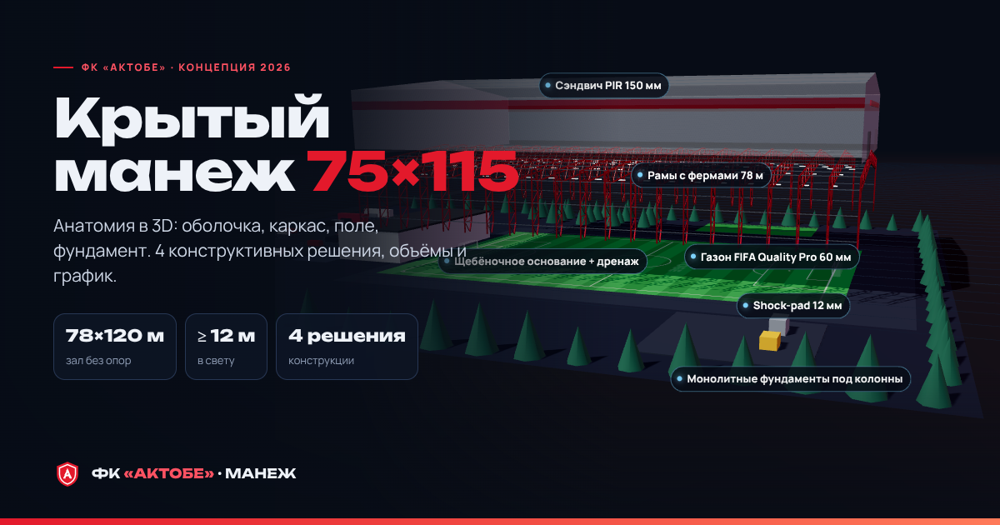

# ФК «Актобе» · Крытый манеж 75×115 м



Одностраничный сайт-концепция: 3D-«анатомия» здания на скролле (оболочка → каркас → поле → внутри → 4 решения), интерактивный конфигуратор, сравнение решений (высоты, теплопотери, энергия, сроки), ведомость объёмов, генплан, график. Без стоимостных показателей.

- Без фреймворков и внешних CDN: Three.js r160 и шрифты лежат в `assets/`.
- Один WebGL-контекст на страницу, рендер только когда что-то меняется.
- Скролл на iPhone/iPad не блокируется: в истории канвас не ловит касания, в конфигураторе вращение включается кнопкой «Вращать 3D».
- Все расчёты — в `assets/js/model.js` (геометрия профиля → площади, объём, тоннаж, теплопотери, энергопотребление).

## Деплой на Vercel
Import репозитория → Framework «Other» → всё берётся из `vercel.json` (`node build.mjs` → `dist/`).
Сборка подставляет адрес проекта в `og:image`, чтобы превью ссылки работало в Telegram/WhatsApp. Для своего домена задайте переменную `SITE_URL=https://ваш-домен`.

## Локально
```
python3 -m http.server 8080   # http://localhost:8080
node scripts/render-og.cjs     # пересобрать og.png (нужен Playwright и запущенный сервер)
```
